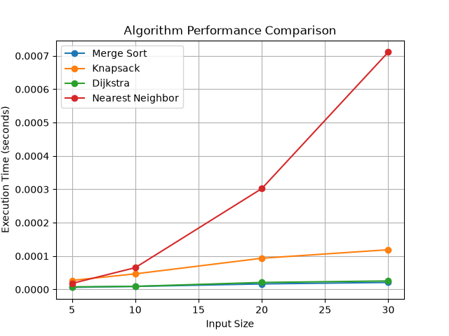
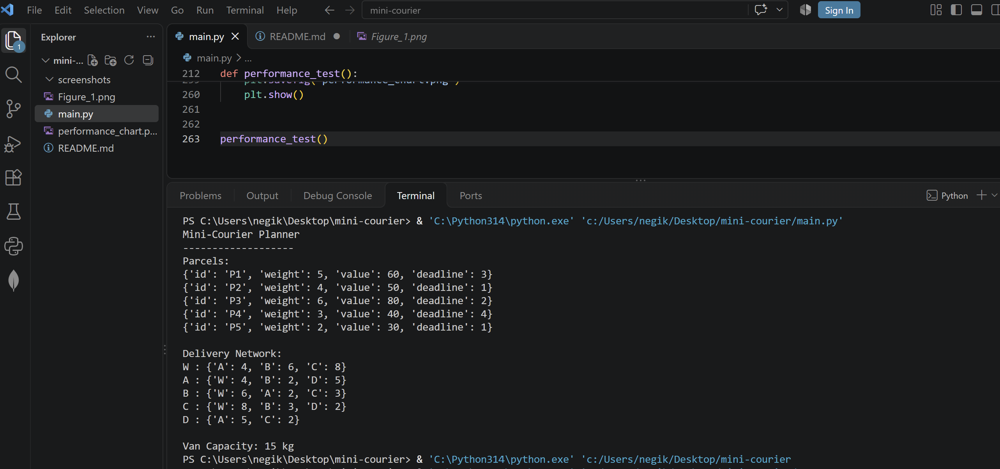
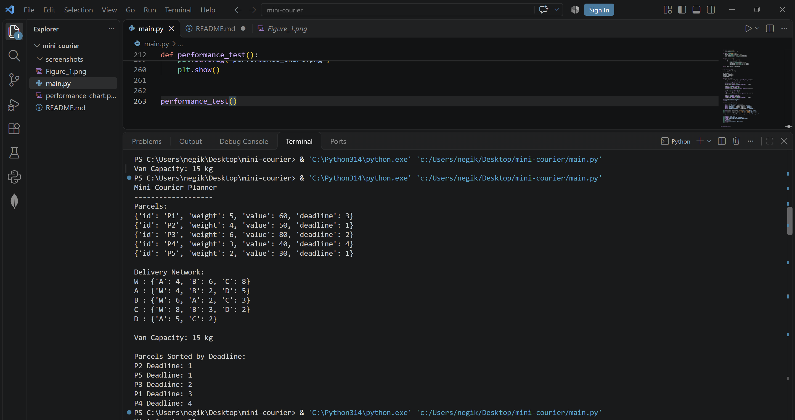
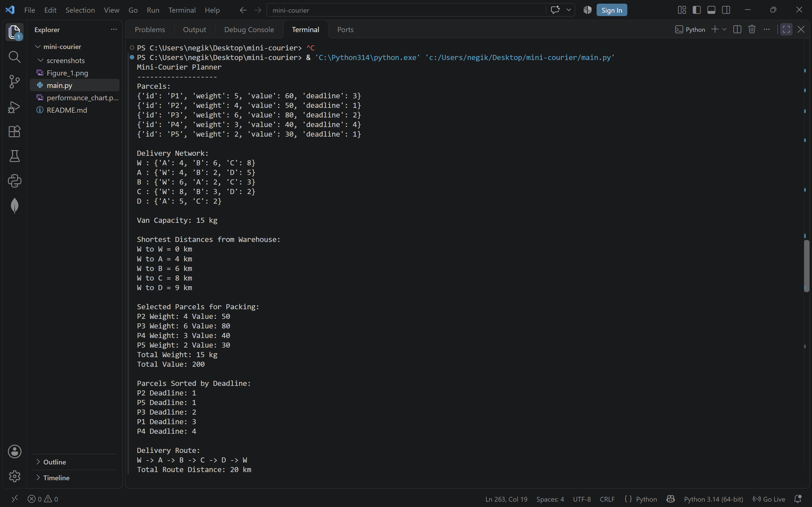
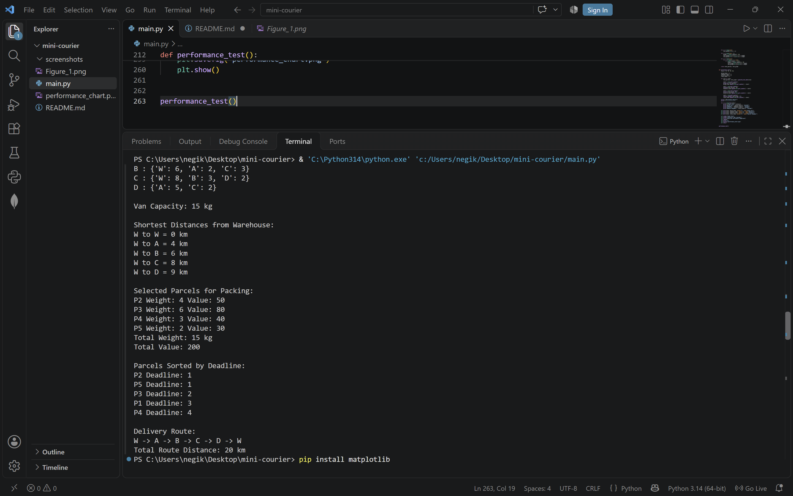
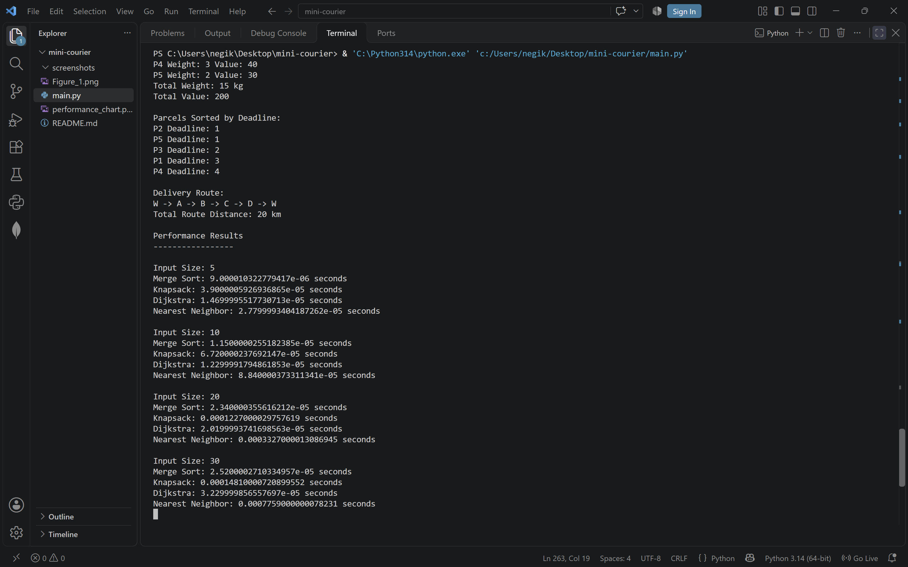

# Mini-Courier Planner

**Student:** ANKUR NEGI
**Roll No.:** 2501010236
**Course:** B.Tech CSE  
**University:** K.R. Mangalam University

## Project Overview

Mini-Courier Planner is a Python-based application that uses algorithmic techniques to optimize parcel selection and delivery routes.

## Algorithms Used

- Merge Sort – Sorting parcels by deadline.
- 0/1 Knapsack – Selecting parcels under van capacity.
- Dijkstra's Algorithm – Finding shortest distances.
- Nearest Neighbor – Approximate delivery route.
- Performance Analysis – Comparing execution times.

## Project Screenshots

### 1. Performance Comparison

### 2. Initial Program Output

### 3. Program Execution

### 4. Parcel Selection and Sorting

### 5. Shortest Distances and Delivery Route

### 6. Final Program Output

### 7. Performance Graph

## Conclusion

This project demonstrates the practical use of Merge Sort, Dynamic Programming, Dijkstra's Algorithm and Nearest Neighbor Approximation in a courier delivery optimization problem.

